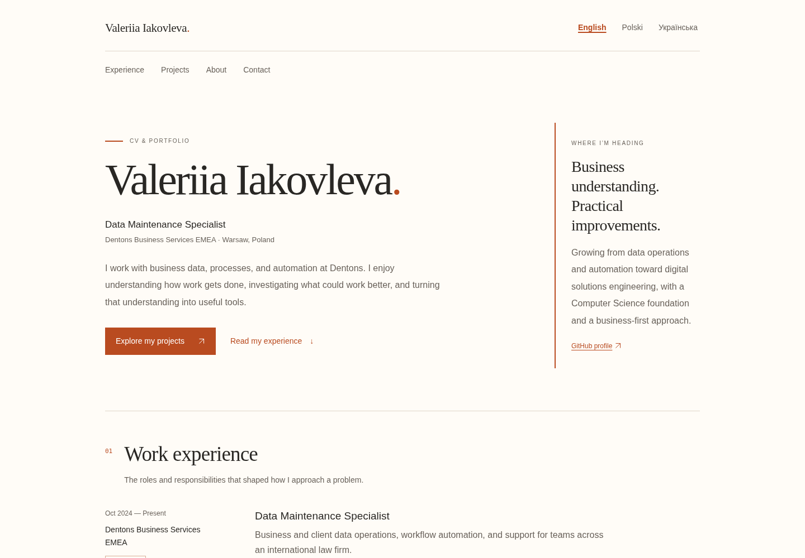
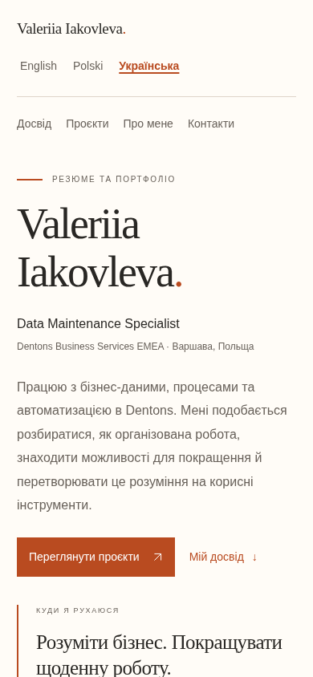

# Verification — CV expansion

Checked 7 November 2026.

- Astro/TypeScript: zero errors, warnings, or hints.
- Production build: four static routes, including all three language pages and English entry redirect.
- Desktop browser: CV layout renders, career history includes all four organizations, and language navigation works.
- Native project disclosure opens and exposes the case-study copy.
- English-to-Polish switching preserves the selected `#projects` section when JavaScript is enabled.
- Ukrainian page: correct language, all four roles, and no unresolved same-page anchor links.
- Responsive browser fixture at 320 pixels: English, Polish, and Ukrainian show no horizontal document overflow (305-pixel content viewport excluding scrollbar).
- Responsive fixture at 390 pixels: mobile visual inspection passed.
- Responsive fixture at 768 pixels: Ukrainian page shows no horizontal document overflow (753-pixel content viewport).
- Temporary responsive fixtures are outside the repository and are not included in the change.

The production output is served by the supported static preview workflow. The Astro dev command exited after launching a background process in this environment, so browser QA uses the actual static build rather than a separate improvised dev server.

Print styles and progressive print-button wiring are present. Physical printing, PDF pagination, screen-reader testing, and additional browser engines have not been verified. Responsive frames are layout checks, not physical-device emulation.

No new dependencies or hosting changes. Public project evidence links use the existing repository and confirmed merged PR #1. Content review is documented separately; draft project status is not upgraded to completed without evidence.

## Content correction checks — 8 November 2026

The updated content passes Astro/TypeScript checks and builds all four static routes. Updated facts cover the EPAM dates and migration work, confirmed programming tools, the single Master File/reporting project, and the ongoing follow-up work. Contact rendering is conditional and personal email is unset. The upload payload must be scanned for personal contact details before submission.

## Repository maintenance and visual polish — 8 November 2026

PR #2 was confirmed open and draft at inspection; its preceding build passed and deploy was skipped. The work continues on `feat/cv-and-project-evidence`. No AGENTS.md files were found in the checkout or applicable workspace locations. The previous chat itself was unavailable; the uploaded brief and existing review notes supplied the scope.

### Current validation

- Node 24.22.1, npm 11.9.0. `npm ci` succeeds with the unchanged dependency versions and lockfile (a writable external npm cache was needed in this cloud sandbox). Astro's installed package declares Node >=22.23.4; the old README minimum was corrected. `.nvmrc` selects Node 24 for development and CI.
- `npm run check`: zero errors, warnings, or hints. Production build emits the English redirect and three language pages.
- `npm run test:site`: checks the built redirect, locale metadata and active navigation, shared official titles, unique IDs, internal links/anchors, base-prefixed assets, and contact privacy. No test dependency was added.
- Headless Chromium 156, using Playwright available in the environment: all three languages at viewport widths 320, 390, 768, and 1440 have no horizontal document overflow. Language and section navigation targets are at least 44px tall.
- All three native disclosures open with Enter and close with Space. The first Tab exposes a visible skip-link focus outline; Enter focuses the main content. Language switches preserve `#projects`; language hrefs also carry the hash for new-tab/copy behavior.
- JavaScript-disabled pages retain content, native disclosures, and language navigation; the optional print button stays hidden. With JavaScript enabled its click calls `window.print()`.
- Reduced-motion preference keeps automatic scrolling. Browser checks recorded no page errors or failed asset responses.
- Generated A4 PDFs in all three languages contain three pages. Print inspection found and fixed an orphaned contact section; project summaries and real evidence links remain, while case-study disclosures and controls are hidden. English PDF pages were rasterized and visually reviewed. PDF text was checked across languages for contact content and page boundaries. PDFs are temporary QA output, not published CV downloads.
- Source/output privacy scan found no email addresses or personal contact URLs. Contact is GitHub-only; unused email/LinkedIn hooks were removed. New Git metadata uses a GitHub noreply identity. Existing Git history was not rewritten.

### Visual evidence

Actual screenshots from the built site, captured 8 November 2026:

- [English desktop, 1440 × 1000](screenshots/desktop-en.png)
- [Ukrainian mobile viewport, 390 × 844](screenshots/mobile-uk.png)
- [Polish project disclosure, 1280 × 1000](screenshots/projects-pl.png)
- [English print layout, page 3](screenshots/print-en.png)

The screenshots show the existing layout and system typography with larger prose, roomier navigation, and restrained status highlighting. They are browser evidence, not physical-device tests.

### Workflow compatibility and limits

Updated checkout and setup-node to v7 and upload-pages-artifact to v5 after reading their official versioned READMEs and release notes. The Node 24 action runtime requires runner >=2.327.1; this workflow uses GitHub-hosted `ubuntu-latest`. Checkout credential persistence is disabled. No registry authentication is configured, so setup-node v7's removal of the dummy auth-token fallback does not affect installation. PRs retain build-only behavior; deploy remains restricted to `main`.

References: [checkout v7](https://github.com/actions/checkout/tree/v7), [setup-node v7](https://github.com/actions/setup-node/tree/v7), [upload-pages-artifact v5](https://github.com/actions/upload-pages-artifact/tree/v5).

Screen readers, physical printing/devices, Firefox, and Safari were not tested. Translation/editorial approval and the existing factual review items remain with the owner. External project evidence is the real public repository, production site, and merged PR #1; employer work has no public artifact. No merge or production deployment was performed.
